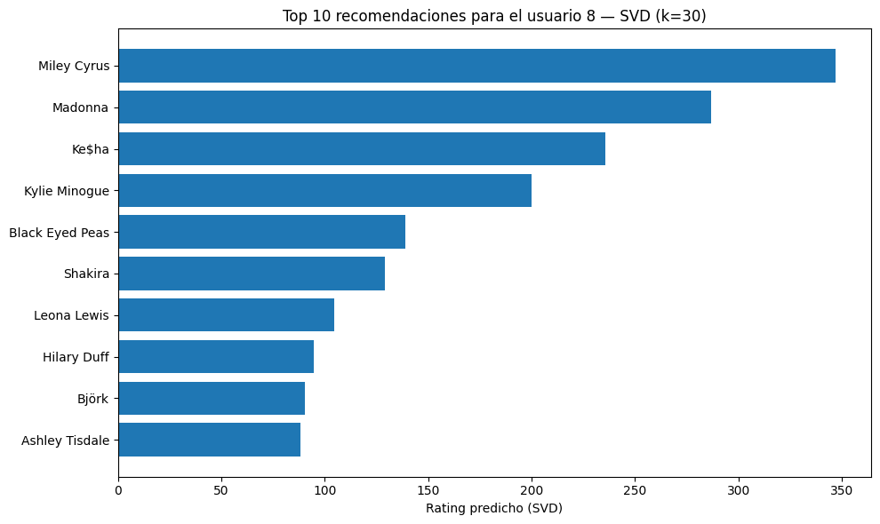

# Music Recommender on Last.fm Data

Four recommendation approaches built and compared on the **HetRec 2011 Last.fm** dataset (users, artists and play counts), with a focus on why the "best" method depends on what you measure.

> 🇪🇸 *Cuatro recomendadores de música (promedios, filtrado colaborativo por coseno, SVD y reglas de asociación) sobre datos de Last.fm. El notebook está en español.*



## Approaches

| Method | Idea |
|---|---|
| Simple average | Average play count per artist among its listeners |
| Weighted average (user-based CF) | Average weighted by cosine similarity between users |
| SVD | Low-rank reconstruction of the user × artist matrix; k chosen by test RMSE (k = 30) |
| Apriori | Association rules between artists (support 0.05, confidence 0.3, lift 2) seeded with the user's top 10 artists |

## Findings

- **Long tail.** Plays are highly concentrated: Britney Spears alone accounts for 3.46 % of all plays. Ranking artists by **reach** (share of users who listened at least once) gives a different top 10 than ranking by raw plays.
- **RMSE is misleading here.** The simple average had the lowest RMSE (2,970.5), then the weighted average (2,980.9) and SVD (3,019.1). Because play counts range from units to tens of thousands, predicting values near the mean minimises squared error without capturing taste.
- **Qualitatively, SVD and Apriori fit the user best.** For the test user (German pop plus mainstream international pop), they produced the most coherent recommendations.
- **Better evaluation.** Ranking metrics (Precision@K, Recall@K) on a held-out set of interactions are the appropriate next step for a top-N task.

## Known limitation

The simple and weighted averages ignore users who never listened to an artist. As a result, they can rank niche artists with a single heavy listener at the top. Imputing missing plays as zero would turn them into popularity recommenders. Both choices are discussed in the notebook.

## How to run

Download `hetrec2011-lastfm-2k` from [GroupLens](https://grouplens.org/datasets/hetrec-2011/), place `artists.dat` and `user_artists.dat` next to the notebook, then:

```bash
pip install -r requirements.txt
jupyter notebook lastfm_music_recommender.ipynb
```

## Stack

Python · pandas · NumPy · SciPy · scikit-learn · apyori · matplotlib

**Author:** Mateo Aranguren
